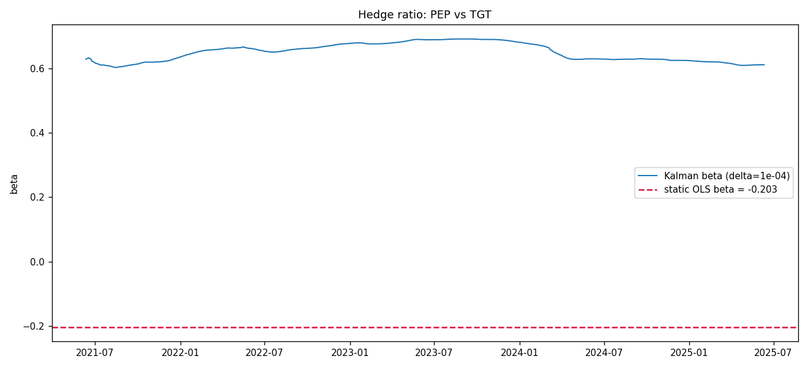
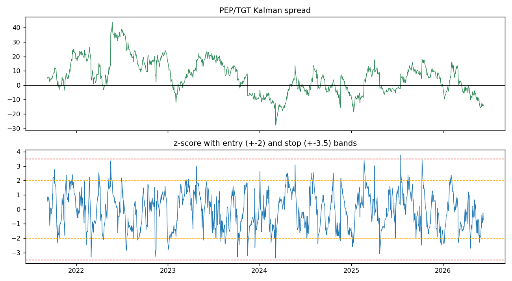
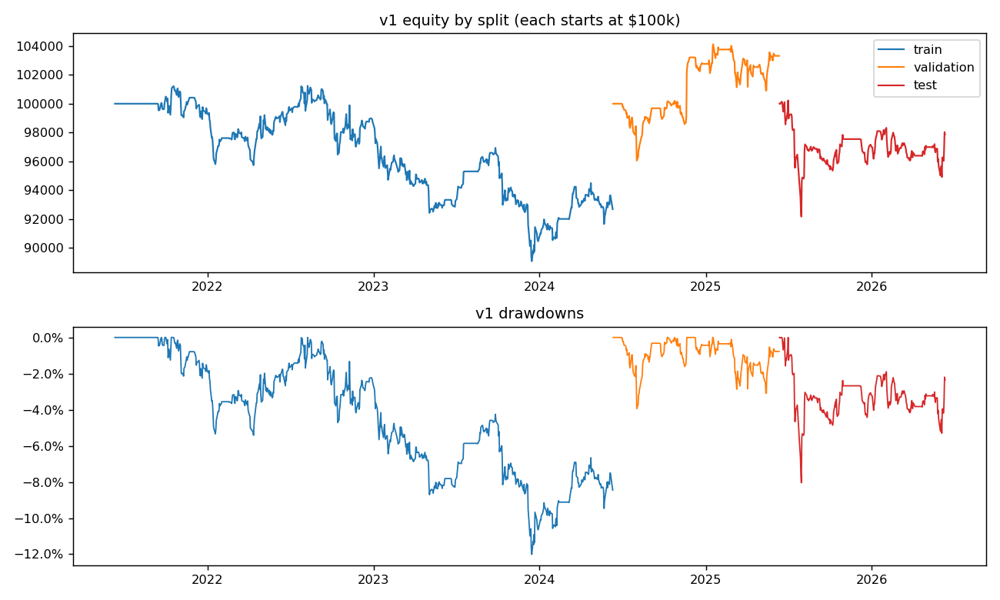
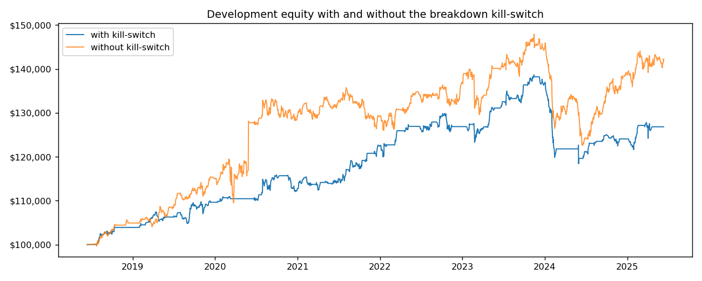
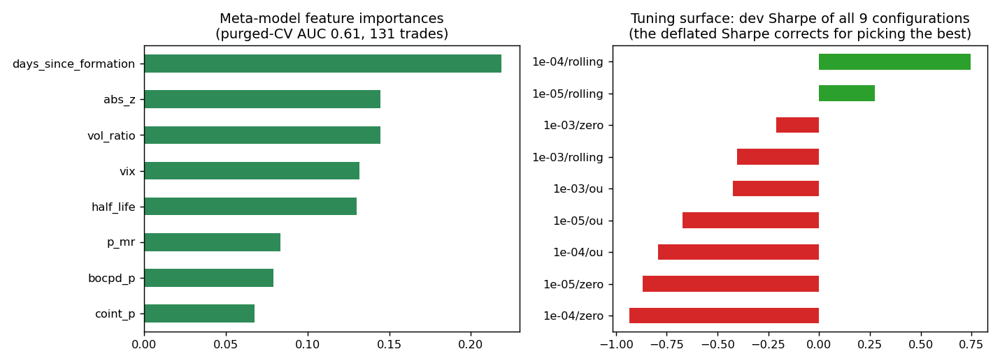
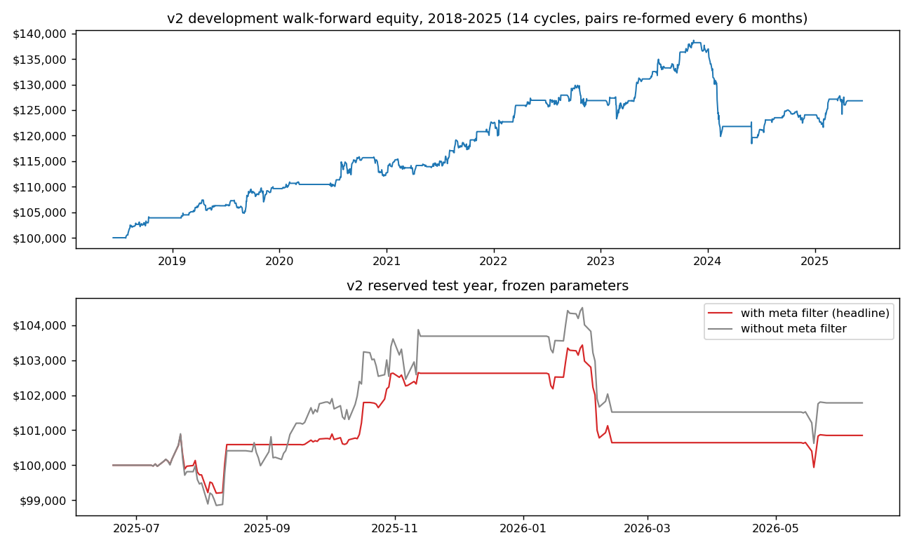

# Statistical Arbitrage: Cointegration, Kalman Filtering, HMM Regimes, and a Walk-Forward Extension

## Overview

Pairs trading is a market-neutral strategy built on a simple observation:
some pairs of stocks share common economic drivers, so their prices move
together over long horizons. When the spread between two linked stocks
widens beyond its normal range without a fundamental reason, the trade is
to buy the laggard, short the leader, and profit as the spread mean
reverts. The position is hedged against overall market direction; the
only bet is on the spread.

This project implements that strategy end to end in Python: statistical
pair selection via cointegration tests, dynamic hedge ratios via Kalman
filtering, regime gating via a hidden Markov model, an event-driven
backtest with realistic transaction costs, and a significance layer that
quantifies how much of the measured performance is attributable to
selection luck. Everything runs locally on free Yahoo Finance data with
simulated capital.

There are two versions:

- **Version 1** is the classic static design: select pairs once, tune
  once, test once. Measured correctly, it earns approximately zero after
  costs (test Sharpe -0.29). I kept that result, because diagnosing why
  it fails is what motivates version 2.
- **Version 2** rebuilds the strategy around those diagnoses: a ~100
  ticker universe over 10 years, walk-forward pair re-formation every six
  months, a Bayesian online changepoint kill-switch on every live pair,
  meta-labeled entry filtering, and deflated Sharpe reporting. The test
  year flips from negative to positive; the deflated Sharpe correctly
  reports that the improvement is promising but not yet statistically
  distinguishable from tuning luck.

## The governing constraint: no look-ahead bias

A backtest is only meaningful if every decision at time t uses only
information available at time t. Violations are usually accidental: a
model fit on the full sample, a smoother that conditions on future
observations, a parameter chosen on the period being reported. Each one
inflates the backtest and disappears in live trading.

I enforce the constraint structurally. The data is split into periods
with strict roles (selection and fitting, tuning, and a reserved test
span evaluated exactly once with frozen parameters), the split boundaries
are computed once and persisted to a single file every module reads, and
every estimator in the codebase is the causal variant: filtered Kalman
states instead of smoothed, the HMM forward algorithm instead of Viterbi,
trailing windows instead of centered ones, and next-bar execution.

## Version 1 architecture

**1. Universe and splits** (`src/universe.py`). Five years of daily
adjusted closes for 40 large-cap US stocks across four sectors, plus the
VIX. Adjusted closes prevent dividends and splits from appearing as
spread dislocations. Gaps are forward-filled to a maximum of two days;
tickers with more than 5% missing data are dropped. Splits: years 1 to 3
train, year 4 validation, year 5 test.

**2. Pair selection** (`src/cointegration.py`). Cointegration is the
precise form of "these stocks move together": each price series is
individually non-stationary (a unit root process), but some linear
combination y - beta*x is stationary. On training data only, every
same-sector pair passes through three gates:

- **ADF tests on each leg.** Both series must fail to reject the unit
  root null (p > 0.05). A series that is already stationary on its own
  cannot be cointegrated with anything in the Engle-Granger sense.
- **Engle-Granger test.** Regress y on x by OLS and test the residuals
  for stationarity. Running a plain ADF test on fitted residuals uses the
  wrong critical values, because OLS has already minimized the residual
  variance; the correct test uses MacKinnon critical values
  (`statsmodels.coint`). I gate on the corrected p-value (p < 0.05) and
  report the naive residual ADF alongside it, which is always flattering,
  so the size of the bias is visible.
- **Half-life filter.** An AR(1) fit on residual changes gives the
  mean-reversion speed lambda, and half_life = -ln(2)/ln(1+lambda). I
  keep half-lives between 5 and 60 trading days: faster reversion is
  consumed by next-bar execution, slower ties up capital while the
  cointegrating relationship has time to break.

**3. Dynamic hedge ratio** (`src/kalman_hedge.py`). A static OLS beta
assumes the hedge relationship is constant for years. I instead model
[beta, alpha] as a random-walk state in a state-space model and estimate
it with a Kalman filter, implemented twice (pykalman and a manual numpy
predict/update loop) with an assertion that the two agree to ~1e-14. The
tradeable spread is the residual under the current filtered state:
spread_t = y_t - beta_t*x_t - alpha_t.

Two noise calibrations dominate everything else in the project, and both
are documented failures I hit and fixed:

- **Observation noise R** is calibrated per pair to the variance of the
  train-period OLS residual. The common textbook value (R = 1e-3 on
  dollar prices) tells the filter prices fit the model to within cents,
  so the state absorbs every dislocation and the residual degenerates
  into white measurement noise with a near-zero half-life. The diagnostic
  was the Kalman spread's half-life collapsing to ~0 days while the OLS
  residual's was 25.
- **Process noise Q** is scaled dimensionally, with the beta component
  divided by scale(x)^2. Beta multiplies the price of x, so an unscaled
  random-walk step on beta moves the model's prediction by dollars per
  day when x trades at $800, and the filter tracks dislocations through
  beta regardless of how small the noise setting is. After scaling, the
  tuning parameter delta means the same thing for every pair: the
  fraction of observation variance the state may absorb per day.



The chart above shows why the Kalman filter earns its place: the dashed
red line is the single OLS hedge ratio estimated once on the training
window, and the blue line is the filtered beta updating day by day. The
relationship between the two stocks drifts materially over the years; a
static hedge leaves the position increasingly mis-hedged, while the
filtered beta tracks the change using only past data at every step.

**4. Regime detection** (`src/regime_detector.py`). Spread mean reversion
is conditional: in stressed markets correlations break and spreads trend.
A 2-state Gaussian HMM is fit on train-period features (20-day spread
volatility, 5- and 20-day return correlations between the legs, VIX
level, 20-day spread momentum, all trailing). The lower-volatility,
lower-momentum, lower-VIX state is labeled mean-reverting, and new
entries are only allowed in that state. Out of sample, the regime at day
t comes from the forward algorithm, P(state_t | observations through t),
computed with an explicit recursion. The Viterbi path is never used: it
conditions each day's state on the full series, including the future.

**5. Signals** (`src/signal_generator.py`). The spread is standardized
into a z-score with trailing windows (expanding for the first 60
observations, then rolling). Entry at |z| > 2 toward the mean, exit when
z crosses 0, stop at |z| > 3.5. Exits are never gated by the regime
model, because blocking a risk reduction is never correct.



This is what the strategy actually trades, shown for the PEP/TGT pair.
The top panel is the Kalman residual spread oscillating around zero; the
bottom panel is its z-score with the entry bands at plus and minus 2
(orange) and the stop bands at plus and minus 3.5 (red). Every excursion
beyond an orange band that later recrosses zero is a potential round
trip; an excursion that reaches red instead is a stopped-out loss.

**6. Backtest and risk** (`src/backtest.py`, `src/risk_model.py`). An
event-driven daily loop on $100,000 simulated capital. Signals at day t's
close fill at day t+1's close, paying 5 bps cost plus 2 bps slippage per
side on gross notional. Sizing risks 2% of current equity per trade,
where risk is the loss at the stop (1.5 z-units beyond entry, converted
to dollars through the spread's trailing standard deviation), with a
gross exposure cap so three concurrent positions never exceed 1x
leverage. Entries are re-confirmed at the fill bar: I measured the mean
|z| decaying from 2.55 at decision to 0.77 at fill, meaning the system
was buying one-day spikes after they had snapped back, so stale orders
cancel instead of filling.

**7. Reporting** (`src/report.py`). Self-contained HTML report with
equity curves, drawdowns, monthly returns heatmap, trade P&L
distribution, and the regime overlay: `results/report.html`.

## Version 1 results

Tuned on validation only (Kalman delta, z-score construction, all chosen
jointly by running the actual validation backtest); test run once,
frozen. Data: June 2021 to June 2026.

| Metric | Train (3y) | Validation (tuning) | Test (held out) |
|---|---|---|---|
| Total return | -7.3% | +3.3% | -2.1% |
| Sharpe | -0.42 | +0.59 | -0.29 |
| Max drawdown | -12.0% | -4.0% | -8.0% |
| Trades | 71 | 19 | 23 |
| Win rate | 53.5% | 52.6% | 60.9% |
| Avg holding | 20.9d | 19.0d | 19.7d |



The equity curves make the table concrete: each split starts at $100,000,
the train period (blue) grinds down through 2022, validation (orange)
drifts modestly up, and the held-out test year (red) loses about 2%. The
drawdown panel below shows the losses were gradual bleed rather than a
single crash, which points at costs and decayed relationships rather than
a discrete event.

Net of 14 bps round-trip costs the edge is approximately zero, which
matches the literature on this strategy: profitable in the 1990s,
arbitraged down through the 2000s on liquid US large caps (Do and Faff).
The trade logs localize the failure precisely: pairs were selected once
and traded for up to five years post-formation, and the largest losses
came from pairs whose cointegrating relationship had ended (MS/BLK
-$1,627 and AMD/META -$1,447 in the test year alone).

## Version 2 architecture

Each component answers a specific measured failure of version 1.

**1. Walk-forward re-formation** (`src/walkforward.py`). Pairs-trading
profits concentrate in the months immediately after formation, and v1's
loss attribution confirms it. v2 re-runs the full cointegration selection
every 126 trading days on a trailing 504-day formation window, across
~100 stocks in four sectors plus the sector ETFs (so stock-vs-ETF pairs
form naturally), over 10 years of data. Each cohort trades for one
126-day window only, so no position ever relies on evidence more than six
months old. Formation strictly precedes trading in every cycle, equity
chains across cycles, and per-cycle pair turnover comes out high, which
confirms that a static selection spends most of its life trading
relationships current data no longer supports.

**2. Breakdown kill-switch** (`src/break_detector.py`). Cointegration
established on a formation window is a hypothesis, not a property, and v1
had no mechanism to withdraw it. v2 monitors every live pair on two
timescales:

- A rolling ADF re-test on the trailing 126 days of spread blocks new
  entries when the p-value exceeds 0.20 (deliberately looser than the
  0.05 selection gate, which freshly selected pairs hover near by
  construction).
- Bayesian online changepoint detection (Adams and MacKay, 2007) on
  standardized daily spread changes, with a Normal-Inverse-Gamma
  conjugate model and Student-t predictive, force-exits the position when
  the run-length posterior concentrates on recent changepoints. Raw
  financial data initially over-triggered the detector because volatility
  clustering mimics changepoints; the fix is a persistence rule
  calibrated on synthetic data, where a single 6-sigma outlier sustains
  the alarm ~3 days but a genuine mean/variance change sustains it 9 to
  10. I require 5 consecutive alarm days. Applied retroactively to v1's
  data, the detector flags both of v1's worst test-year breakdowns. All
  thresholds are fixed a priori rather than tuned, to keep the trial
  count for the deflated Sharpe honest.



The ablation above runs the identical development walk-forward twice,
with the kill-switch on (blue) and off (orange). The two curves track
each other most of the time, which is expected: the kill-switch is tail
protection, not a return engine. Its value shows up in the episodes where
the orange curve lurches down on a broken pair the blue curve had already
exited.

**3. OU s-scores, implemented and rejected** (`src/ou_model.py`). I
implemented Avellaneda-Lee s-scores: fit the spread's Ornstein-Uhlenbeck
dynamics on the formation window (via the AR(1) representation), freeze
the equilibrium m and stationary sigma_eq, and score dislocations as
s = (spread - m)/sigma_eq. Unlike a short rolling standard deviation,
sigma_eq cannot be inflated by the dislocation being traded. I expected
this to beat the rolling z-score; on the development walk-forward it did
not, and the tuner selected the rolling score. I report the negative
result because a selection process that never rejects the designer's
preferred method is not selecting.

**4. Meta-labeling** (`src/meta_label.py`). Following Lopez de Prado: the
primary rules decide when a trade triggers, and a gradient-boosted
classifier estimates, from decision-time features (|z| at entry,
formation half-life and cointegration p-value, days since formation,
filtered regime probability, VIX, spread volatility ratio, changepoint
probability), whether that particular trigger wins. This puts machine
learning on the well-posed problem (classifying labeled trade outcomes)
rather than the ill-posed one (finding alpha in prices). Because trades
overlap in time and share market state, ordinary K-fold cross-validation
leaks; I use purged chronological folds with a 60-day embargo equal to
the maximum holding period. The probability threshold (0.5) and the size
multiplier are fixed a priori, not tuned. Purged-CV AUC: 0.61, with
days-since-formation the most informative feature, which independently
confirms the walk-forward thesis.

**5. Significance statistics** (`src/stats_validation.py`). Tuning
evaluated nine configurations and kept the best, and the maximum of nine
noisy Sharpe estimates is biased upward even under the null of zero edge
everywhere. I report the probabilistic Sharpe ratio (probability the true
Sharpe exceeds zero, adjusted for skew and kurtosis), the deflated Sharpe
ratio (the same test against the expected maximum of N luck-only trials,
with N taken from the recorded tuning history), and a moving-block
bootstrap confidence interval that preserves return autocorrelation.



Left panel: what the meta-model learned. Days since formation dominates,
meaning the single best predictor of whether a triggered trade wins is
how fresh the pair's statistical evidence is, which independently
confirms the walk-forward design. Right panel: the complete tuning
surface, all nine configurations with their development Sharpes. Showing
the whole surface rather than only the winner is the point: the winner
(+0.75) sits well above the rest, but eight of nine cells are negative,
and the deflated Sharpe accounts for the fact that I got to pick the
maximum.

## Version 2 results

Development span 2016 to 2025 (14 walk-forward cycles), reserved test
year 2025 to 2026 run once with everything frozen. I committed to the
meta-filtered run as the headline before seeing either test number.

| Span | Return | Sharpe | PSR | DSR | 90% bootstrap CI |
|---|---|---|---|---|---|
| Development (6.5y, 131 trades) | +26.8% | +0.75 | 0.97 | 0.39 | (+0.01, +1.46) |
| Test, meta filter (headline) | +0.9% | +0.35 | 0.63 | 0.31 | (-1.48, +2.41) |
| Test, no meta (ablation) | +1.8% | +0.51 | 0.69 | 0.36 | (-1.07, +1.91) |
| v1 test, comparison | -2.1% | -0.29 | | | |



Top panel: the development walk-forward equity over fourteen 6-month
cycles, 2018 to 2025, compounding to +26.8%. The curve is not smooth and
should not be: it includes flat stretches where the regime gate and
kill-switch kept the system mostly out of the market. Bottom panel: the
reserved test year under frozen parameters, run with the meta filter
(red, the pre-committed headline) and without it (gray, the ablation).
Both end positive where v1's test year ended at -2.1%, and the gap
between them is the meta filter's out-of-sample cost on a twelve-trade
sample.

Interpretation. PSR is the probability the true Sharpe exceeds zero; DSR
is the probability it exceeds the expected maximum of nine luck-only
trials. The redesign moved the test year from negative to positive, and
the development Sharpe of 0.75 over 6.5 years is individually significant
against zero (PSR 0.97). But DSR ~0.4 means the result does not yet
clearly beat selection luck, and the test-year intervals straddle zero on
12 to 14 trades. The meta filter, despite genuine cross-validated skill,
marginally hurt on that small sample.

The honest summary: every mechanism works as designed and the direction
of improvement matches the diagnosis that motivated it, but the evidence
does not yet support calling it edge. Raising the DSR requires more
independent data: another decade, another market, or intraday frequency.
The architecture makes any of those a data swap rather than a redesign.

Two caveats stated plainly: the reserved test year overlaps v1's
already-consumed test year (v2's parameters were never fitted to it, but
truly virgin data requires waiting for the future), and the static ticker
list is survivorship-tilted toward companies that existed through 2026.

## Running it

Everything runs locally on free data. The notebooks import the same
functions as the pipeline, so the whole system can be driven from
Jupyter.

```bash
pip install -r requirements.txt
python3 run_pipeline.py            # v1 end to end
python3 run_pipeline.py v2         # v2 end to end
python3 run_pipeline.py v2 --force # re-download and re-tune from scratch
open results/report.html           # v1 report
open results/report_v2.html        # v2 report
```

Individual stages run standalone: `python3 -m src.universe`,
`-m src.cointegration`, `-m src.kalman_hedge`, `-m src.regime_detector`,
`-m src.backtest`, `-m src.walkforward`, `-m src.report`.

Notebooks (pre-executed with outputs):

- `01_pair_selection.ipynb`: the cointegration pipeline step by step,
  with the statistical reasoning for each gate.
- `02_strategy_walkthrough.ipynb`: one pair through every layer of v1.
- `03_performance_analysis.ipynb`: v1 results, loss attribution, tuning
  surface fragility.
- `04_walkforward_and_breaks.ipynb`: the walk-forward engine, pair
  turnover, OU s-scores, and the kill-switch ablation.
- `05_metalabeling_and_significance.ipynb`: the meta-model, purged CV,
  and the deflated Sharpe analysis.

Rebuild with `python3 notebooks/build_notebooks.py` then
`jupyter nbconvert --execute --to notebook --inplace notebooks/0*.ipynb`.

## Limitations

- Free yfinance data: survivorship tilt, no borrow costs or short
  availability modeling.
- v1 is a single five-year sample; v2 adds walk-forward breadth but
  remains one universe and one decade.
- Simulated capital. Not investment advice.
